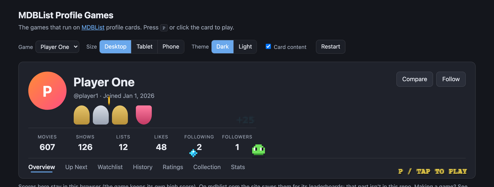

# MDBList Profile Games

Small games that play right on an [MDBList](https://mdblist.com) profile card. The first is
**Player One**, a pixel-art platformer: a little blob hops around the card on its own (the demo),
and when you press **P** or tap the card, the card becomes a level. Run, jump, grab coins and gems,
stomp beetles, dodge spikes and comets, and level up.

## Play it

Download or clone this repo and open `index.html` in a browser. No build step, no server, no
dependencies.

The playground shows a stand-in profile card. You can switch between desktop, tablet and phone
widths, dark and light themes, and an empty card. Scores stay in your browser.

On mdblist.com, every signed-in user can play on any profile that shows the game. The site saves
scores to weekly and all-time leaderboards; that part lives on the site and isn't in this repo.

## What's here

| File | What it is |
|---|---|
| `index.html` | The playground |
| `runtime.js` | Runs a game on a canvas over the card: sizing, the animation loop, pausing off screen. The same runner mdblist.com uses. |
| `games/player-one.js` | Player One. The exact file mdblist.com runs. |
| `tools/check-games.js` | Checks every game against the rules in CONTRIBUTING.md (also runs on every pull request) |

## Contributing

Improvements to Player One and new games are welcome. Read [CONTRIBUTING.md](CONTRIBUTING.md)
first: it explains how a game plugs in, and the rules a game must follow to run on mdblist.com.

## License

[MIT](LICENSE)
